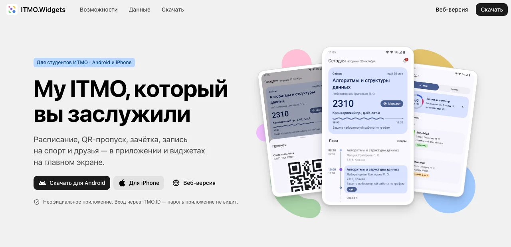
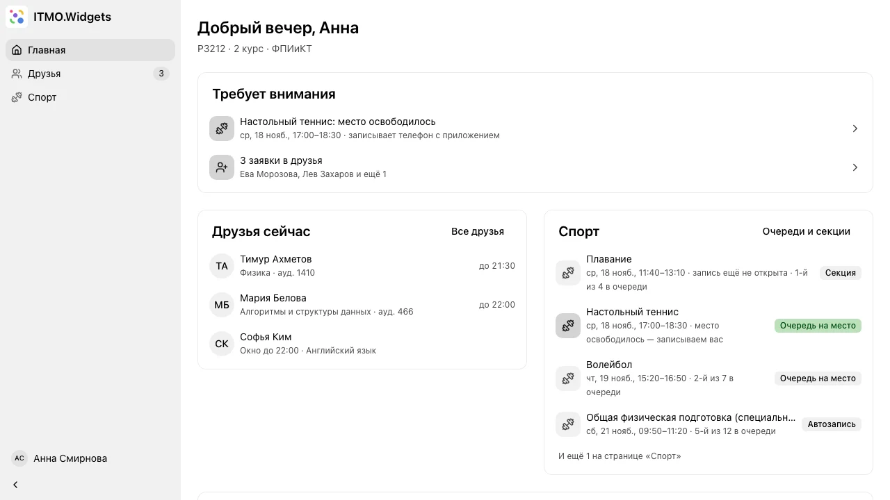

<p align="center">
  
</p>

<h1 align="center">ITMO.Widgets Web</h1>

<p align="center">
  <strong>Сайт и веб-версия ITMO.Widgets</strong>
  <br />
  Лендинг, политика конфиденциальности и веб-версия приложения на widgets.alllexey.dev
</p>

<p align="center">
  <a href="https://widgets.alllexey.dev"></a>
  
  
</p>

<p align="center">
  <a href="https://widgets.alllexey.dev"><strong>Сайт</strong></a> ·
  <a href="https://widgets.alllexey.dev/app/">Веб-версия</a> ·
  <a href="https://widgets.alllexey.dev/privacy.html">Конфиденциальность</a> ·
  <a href="CHANGELOG.md">История изменений</a>
</p>

<p align="center">
  <a href="https://widgets.alllexey.dev">
    <picture>
      <source media="(prefers-color-scheme: dark)" srcset="docs/images/landing-dark.webp">
      
    </picture>
  </a>
</p>

Всё, что открывается на `widgets.alllexey.dev`: сайт приложения
[ITMO.Widgets](https://github.com/alllexey-dev/ITMO.Widgets) для Android и iPhone и его веб-версия.

## Что здесь

- **Сайт**: [лендинг](https://widgets.alllexey.dev), [политика конфиденциальности](https://widgets.alllexey.dev/privacy.html)
  и [страница удаления аккаунта](https://widgets.alllexey.dev/delete-account).
- **Веб-версия**: [widgets.alllexey.dev/app](https://widgets.alllexey.dev/app/) с главной, друзьями, спортом,
  профилем и устройствами. У модераторов и администраторов в ней есть свои разделы.
- **Страницы ссылок**: `/u/*`, `/sport/*` и `/pair`. Их открывает приложение, а тем, у кого его нет,
  они подсказывают, где его скачать.

## Веб-версия

<p align="center">
  <a href="https://widgets.alllexey.dev/app/">
    <picture>
      <source media="(prefers-color-scheme: dark)" srcset="docs/images/cabinet-dark.webp">
      
    </picture>
  </a>
</p>

Пароль ИТМО в браузере не нужен: вход подтверждает телефон.

1. Откройте [widgets.alllexey.dev/app](https://widgets.alllexey.dev/app/) на компьютере: появится QR-код.
2. В приложении: Профиль -> Устройства -> Подключить устройство, отсканируйте QR.
3. Проверьте, что в приложении указан этот браузер, и подтвердите.

Отключить браузер можно там же, в разделе "Устройства", или кнопкой "Выйти" в веб-версии.

## Экосистема

| Репозиторий | Что это |
|---|---|
| [ITMO.Widgets](https://github.com/alllexey-dev/ITMO.Widgets) | Приложение для Android и iPhone |
| [itmo-widgets-backend](https://github.com/alllexey-dev/itmo-widgets-backend) | Сервер: друзья, приватность, очереди на спорт, отзывы, уведомления |
| **itmo-widgets-web** (этот репозиторий) | Сайт и веб-версия |
| [itmo-widgets-agent](https://github.com/alllexey-dev/itmo-widgets-agent) | Агент для компьютера или сервера: автозапись на спорт без телефона |
| [itmo-mcp](https://github.com/alllexey-dev/itmo-mcp) | MCP-сервер ИТМО для Claude, Codex, Cursor и других ассистентов |
| [my-itmo-api](https://github.com/alllexey-dev/my-itmo-api) | Библиотека для My ITMO и БАРС: Kotlin Multiplatform и Java |

## Разработчикам

### Запуск

Нужен Node.js 22 (`web/.nvmrc`).

```bash
cd web
npm ci
npm run dev        # http://localhost:5183/, запросы /api уходят на dev-сервер
npm run dev:demo   # http://localhost:5184/app/, веб-версия на выдуманных данных, без входа и без сервера
```

В режиме разработки страницы сайта рисует React в браузере. Сайт в том виде, в каком он уходит в прод
(готовый HTML без JavaScript), виден только после сборки:

```bash
cd web && npm run build && npm run preview   # http://localhost:4174/, без заголовков nginx
docker compose up --build                    # http://127.0.0.1:8080/, образ целиком, без API
```

Проверки перед PR:

```bash
scripts/verify.sh        # линтер, типы, тесты и сборка web/
scripts/verify.sh site   # собирает Docker-образ и проверяет адреса, заголовки и правила страниц
```

### Документация

- [docs/site.md](docs/site.md): структура репозитория, как собираются публичные страницы, ссылки на
  приложение, заголовки и CSP, скриншоты лендинга, проверки.
- [docs/deploy.md](docs/deploy.md): выкладка на dev и prod, проверка после неё и откат.
- [web/README.md](web/README.md): веб-версия (в коде и документах она называется кабинетом), её разделы и
  команды.
- [web/docs/architecture.md](web/docs/architecture.md) и [web/docs/design.md](web/docs/design.md):
  архитектура и правила дизайна.

## Обратная связь

Ошибки и идеи: [форма обратной связи](https://fb.widgets.alllexey.dev),
[Issues](https://github.com/alllexey-dev/itmo-widgets-web/issues) или
[@itmowidgets](https://t.me/itmowidgets).

---

Неофициальный проект, не связан с Университетом ИТМО.
